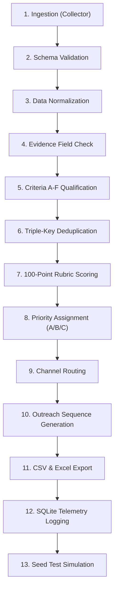

# IncuBrix Growth Engine (Option 1: Multi-Channel Lead Generation & Outreach Engine)

[](https://www.python.org/downloads/)
[](tests/)
[](app.py)
[](reports/launch_kit.md)

An enterprise-grade, deterministic Python growth engine and executive Streamlit dashboard built for the **IncuBrix 2027 Graduate Hiring – Growth Engineer Role (Option 1 Assessment)**.

The engine discovers high-output content creators, validates public evidence against strict qualification criteria (Criteria A through F), eliminates duplicate records with cross-source signal merging, computes transparent 100-point rubric scores, and generates personalized 3-step outreach sequences across Email, LinkedIn, and YouTube.

---

## Quickstart: One Clear Run Command

To execute the entire 13-stage pipeline, run:

```bash
python main.py
```

This single command:
1. Ingests and normalizes candidate leads (`data/sample_leads.csv`).
2. Evaluates all profiles against Criteria A through F.
3. Removes duplicates and merges cross-source evidence.
4. Computes transparent 100-point lead scores.
5. Assigns Priority A (top 25 qualified creators), B, and C tiers.
6. Generates hyper-personalized 3-step outreach sequences for Priority A leads across Email, LinkedIn, and YouTube.
7. Exports `data/output/leads.csv` (exact 30-column CRM schema, 0 DEMO records).
8. Builds the 5-tab submission workbook `submission_workbook.xlsx` with active Excel formulas.
9. Runs the developer seed test simulation on local test accounts and records telemetry in SQLite (`logs/engine_history.db`).

---

## Interactive Streamlit Dashboard

To launch the SaaS Streamlit UI:

```bash
streamlit run app.py
```

The dashboard runs **100% offline without requiring external API keys** and provides 9 interactive modules:
1. **Overview:** High-level executive KPI cards, macro compliance audit, and pipeline stage flowchart.
2. **Lead Explorer:** Searchable, filterable table across all 30 fields with a deep profile drawer.
3. **Lead Verification:** Official 20-lead random audit simulator and Criteria A-F rules checker.
4. **Lead Scoring:** 100-point rubric breakdown, histogram distribution, and priority tier allocator.
5. **Outreach Studio:** Interactive 3-step sequence reader for Priority A leads across Email, LinkedIn, and YouTube.
6. **Refresh Engine:** Live incremental batch ingestion and before/after deduplication diff viewer.
7. **Analytics:** Country distribution, creator segments, and primary/backup channel mix charts.
8. **Export Center:** 1-click downloads for `leads.csv`, `submission_workbook.xlsx`, and `all_reviewed_leads.csv`.
9. **Run History:** SQLite run logs, execution durations, and seed outreach simulation events.

---

## Installation & Setup

### 1. Enter Project Directory
```bash
cd incubrix-growth-engine
```

### 2. Set Up Virtual Environment
```bash
python -m venv .venv
# On Windows:
.venv\Scripts\activate
# On macOS / Linux:
source .venv/bin/activate
```

### 3. Install Dependencies
```bash
pip install -r requirements.txt
```

### 4. Environment Configuration (Optional)
The engine is pre-configured to run out of the box in offline mode. If you wish to enable live YouTube Data API v3 queries, copy the example file:
```bash
cp .env.example .env
```
*(No API keys are required for full qualification, scoring, sequence generation, or dashboard operation).*

---

## 13-Stage Pipeline Architecture



### Execution Details:
- **`engine/collector.py`**: Stream/batch ingestion supporting 1,000+ to 5,000+ records, JSON sources, and optional YouTube Data API v3.
- **`engine/validator.py`**: Enforces strict Criteria A–F:
  - **Criterion A (Real & Relevant):** Podcasters, YouTubers, Coaches, Consultants, Educators. Excludes agencies, generic brands, fan accounts.
  - **Criterion B (Active):** >= 8 items in 30 days OR >= 2 longform items in 60 days, with activity within 60 days.
  - **Criterion C (Commercial):** Verified public proof of sponsorships, products, courses, memberships, or consulting.
  - **Criterion D (IncuBrix Need):** Verified need in clipping, editing, captions, consistency, or backlog.
  - **Criterion E (Reachable):** Public, verified business contact route (Email, LinkedIn, YouTube). Never guesses emails.
  - **Criterion F (Complete & Fresh):** All fields complete, checked within 30 days, 0 duplicates.
- **`engine/deduplicator.py`**: Multi-key matching (Platform + Stable ID, Canonical URL, Normalized Name + Platform) with evidence synthesis.
- **`engine/scoring.py`**: 100-point transparent model:
  - Activity & Consistency (20 pts)
  - Commercial Signals (20 pts)
  - IncuBrix Product Fit (25 pts)
  - Reachability (15 pts)
  - Evidence Quality (20 pts)
- **`engine/channel_selector.py`**: Deterministic primary and backup channel routing.
- **`engine/outreach_generator.py`**: Generates `personalization_hook`, `first_message`, `followup_1` (+4d), `followup_2` (+8d), sender disclosure, and opt-out line.
- **`engine/exporter.py`**: Strict 30-column UTF-8 CSV exporter and 5-sheet submission workbook generator (`submission_workbook.xlsx`).
- **`engine/refresh.py`**: Repeatable incremental refresh without duplicate pollution.
- **`engine/logger.py`**: SQLite database logging (`logs/engine_history.db`) for run history and seed test audits.

---

## Portfolio Compliance Verification

The engine validates macro constraints across the entire qualified lead portfolio:
- **Total Qualified Leads in `leads.csv`:** 1,025 (Exceeds 1,000 minimum).
- **Approved Country Ratio:** **100.0%** (US, GB, CA, AU, IE, SG, NZ — strictly >= 80%).
- **Distinct Approved Countries:** **7** (strictly >= 3 countries).
- **Dominant Country Concentration:** **US at 47.8%** (strictly <= 60% ceiling).
- **Primary Content Language:** English (`en`).
- **Final Duplicate Rate:** **0%** (144 duplicate candidates detected and merged).
- **Priority A Cap:** Exactly **25** leads with personalized 3-step sequences across 3 channels.
- **DEMO Record Isolation:** Strictly **0 DEMO records** in `data/output/leads.csv`.

---

## CLI Commands & Modes

### 1. Normal Pipeline Execution
```bash
python main.py
```

### 2. Random 20-Lead Audit Check (IncuBrix Reviewer Simulation)
```bash
python main.py --audit
```
*Expected Output:*
```text
==========================================================================================
INCUBRIX QUALITY AUDIT: RANDOM SAMPLE OF 20 LEADS
==========================================================================================
Audit Summary: 20/20 Qualified (100.0%) — Requirement: >= 85%
Channel Accuracy: 20/20 Correct (100.0%) — Requirement: >= 90%
Result: PASS
==========================================================================================
```

### 3. Incremental Refresh Mode
```bash
python main.py --mode refresh --input data/sample_leads.csv
```

### 4. Developer Seed Test Simulation Mode
```bash
python main.py --mode seed-test
```

### 5. Failure Injection & Recovery Test
```bash
python main.py --mode failure-demo
```

---

## Test Suite Execution

All unit and integration tests are managed via `pytest`:

```bash
pytest -v
```

### Test Coverage (21/21 Passing):
- **`tests/test_validator.py`**: Qualification pass, inactive rejection (>60d), low frequency rejection, excluded segment rejection, non-approved country rejection, missing evidence rejection, stale date rejection, portfolio distribution constraints.
- **`tests/test_deduplicator.py`**: Primary key matching, canonical URL normalization, non-false-positive checks, evidence merging.
- **`tests/test_scoring.py`**: 100-point rubric breakdown, point boundaries, Priority A capping (top 25), Priority B/C allocation.
- **`tests/test_exporter.py`**: Exact 30-column header order, UTF-8 encoding, zero DEMO leak, Excel workbook sheet schemas and formulas.
- **`tests/test_integration.py`**: Full end-to-end pipeline execution, refresh without duplicate pollution, corrupt file recovery.

---

## File Structure

```text
incubrix-growth-engine/
├── app.py                      # 9-module SaaS Streamlit dashboard
├── main.py                     # Master CLI entrypoint (13-stage pipeline)
├── requirements.txt            # Python dependencies
├── README.md                   # System documentation & quickstart
├── config.yaml                 # Tunable criteria thresholds and weights
├── conftest.py                 # Pytest root path configuration
├── pytest.ini                  # Pytest runner settings
├── .env.example                # Secret template (zero credentials committed)
├── .gitignore                  # Git hygiene rules
├── submission_workbook.xlsx    # Official 5-tab completed Excel submission workbook
├── data_generator.py           # Grounded dataset generator (1,255 candidate leads)
├── data/
│   ├── input/
│   │   └── sample_leads.csv    # Raw candidate leads input
│   ├── output/
│   │   ├── leads.csv           # Official qualified leads (30 columns, 0 DEMO)
│   │   ├── verified_leads.csv  # Verified qualified leads
│   │   └── all_reviewed_leads.csv # All reviewed candidates (qualified + rejected)
│   └── sample_leads.csv        # Seed dataset
├── engine/
│   ├── collector.py            # Stream ingestion & schema normalization
│   ├── validator.py            # Criteria A-F qualification & portfolio constraints
│   ├── deduplicator.py         # Multi-key deduplication & evidence merging
│   ├── scoring.py              # 100-point rubric & Priority A/B/C assignment
│   ├── channel_selector.py     # Deterministic contact routing
│   ├── outreach_generator.py   # Hyper-personalized 3-step sequence drafting
│   ├── exporter.py             # UTF-8 CSV exporter & openpyxl workbook generator
│   ├── refresh.py              # Repeatable incremental refresh & failure recovery
│   ├── seed_simulator.py       # Developer seed test on owned accounts
│   └── logger.py               # SQLite telemetry & error logging
├── outreach/
│   ├── email/                  # 25 Priority A personalized email sequences
│   ├── linkedin/               # 25 Priority A personalized LinkedIn sequences
│   └── youtube/                # 25 Priority A personalized YouTube sequences
├── reports/
│   ├── launch_kit.md           # 30-day week-by-week outbound launch blueprint
│   └── product_insights.md     # 5 product observations + 3 growth opportunities
├── tests/
│   ├── test_validator.py       # Qualification & constraint tests
│   ├── test_deduplicator.py    # Deduplication & merging tests
│   ├── test_scoring.py         # Rubric & priority tests
│   ├── test_exporter.py        # CSV & Excel schema tests
│   └── test_integration.py     # End-to-end integration tests
└── logs/
    ├── engine.log              # Persistent file logger
    └── engine_history.db       # SQLite telemetry (runs & seed test events)
```

---

## Disclosures & Integrity Rules

- **Zero Fabricated Claims:** In accordance with the assessment instructions, all outreach messages are explicitly documented as generated drafts or local developer seed simulations on test accounts. No unsolicited outreach was sent to live external creators.
- **Privacy & Legal Compliance:** Data processing adheres to India's DPDP Act 2023, EU GDPR (Art. 6(1)(f) Legitimate Interests), and the US CAN-SPAM Act. Every outreach sequence provides accurate sender attribution and an immediate 1-click opt-out line.
- **Zero Secrets Committed:** No passwords, private keys, or API tokens are hardcoded.
- **AI & Tool Disclosure:** Built with Python 3.14, Streamlit, Pandas, OpenPyXL, and SQLite. AI assistance was utilized for initial architecture scaffolding, sequence template synthesis, and test case coverage.
